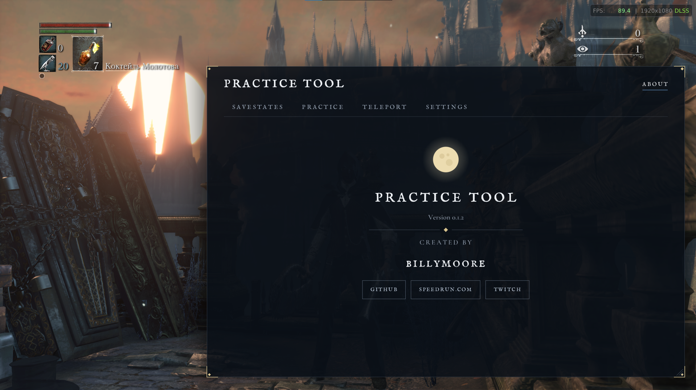
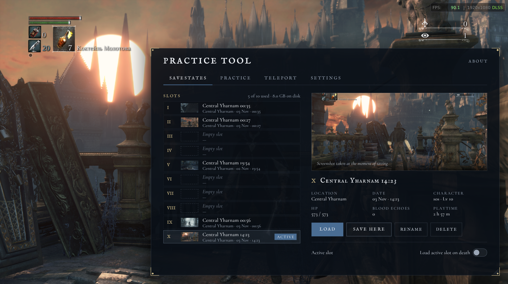

# Bloodborne Practice Tool

A practice tool with real savestates for the PC port of Bloodborne, [bbport](https://github.com/Supermedo/bloodborne_pc).

<p align="center"></p>

<p align="center"></p>

## Install

1. Download `BloodbornePracticeTool-v….zip` from the [latest release](https://github.com/billymooreq/bloodborne-practice-tool/releases/latest) and unpack it.
2. Open the folder of the game program: `...\bbport-windows\bin` (the folder that has `bb-probe.exe` in it).
3. Copy `pdh.dll` and the `practice-tool` folder into it.
4. Start the game as usual: the bbport launcher, then **PLAY**. Press **Home** in the game to open the menu.

**You need:** bbport **1.9.5 or newer** (Bloodborne CUSA03173, version 1.09), Windows 10 or 11. Play **offline** only.

## What it does

- **Savestates of the whole world** in 10 slots: enemies, bosses, items and your hunter come back exactly as they were.
- **They keep working** after you die, after you restart the game and even after you restart your PC.
- **A menu inside the game** (press Home), made to look like Bloodborne.
- **Cheats:** immortal, endless stamina, endless consumables, stealth, silent steps, set Blood Echoes and Insight, refill Blood Vials and Quicksilver Bullets.
- **Teleport** to positions you saved.
- **Your own hotkeys** for every action.

## Keys

| Key | Action |
|---|---|
| Home | Open / close the menu |
| F5 | Save a state to the active slot |
| F9 | Load the active slot |

Everything else (next slot, teleport, immortal and the other options) has no key until you set one in the menu, **Settings** tab.

## Uninstall

Delete `pdh.dll` from the `bin` folder. The game then runs as before.
Also delete the `practice-tool` folder if you don't need your saved states any more.

## Problems and questions

**The menu does not open.**
Check that `pdh.dll` is in the `bin` folder next to `bb-probe.exe` (not next to `Bloodborne.exe`), that the game window is active.

**My antivirus warns about pdh.dll.**
The tool works by putting a file named `pdh.dll` next to the game so that Windows loads it into the game, and then it changes the game in memory. Some malware works the same way, so antivirus programs may be suspicious of it. The tool does not connect to the internet and does not touch anything outside the game. You can check the file's SHA-256 against the one on the release page, read the source code here, or build the DLL yourself. If you trust it, add an exception for the `bin` folder in your antivirus.

**It stopped working after I updated bbport.**
The tool works with new bbport versions by itself. If the menu says *"New bbport version: some things may not work correctly"*, that version was not tested yet: everything stays on, but if something breaks, tell us. Savestates made in another bbport version may not load correctly.

**Where are my saved states, and how much space do they take?**
In `bin\practice-tool\slots`. The first state takes about 2 GB; later ones add much less, because identical parts are stored only once. The **Settings** tab shows the folder and how much space is used. The tool always leaves at least 2 GB free on the drive.

**The game crashed. How do I help find the cause?**
Open `bin\practice-tool\practice-tool.ini`, find the `[options]` section and add the line `crash_dump=1`. Play as usual. After the next crash, send the files from `bin\practice-tool\logs`: `bbstate.log`, the newest `game_*.log` and the `crash_*.dmp` file.

## Known issues

- **The Hunter's Dream is completely black.** This can happen if you loaded a state and then travelled to the Hunter's Dream later. Fix: quit to the main menu and choose **Continue**. If it is still black, restart the game.

## Credits

- Created by **billymoore** · [GitHub](https://github.com/billymooreq) · [speedrun.com](https://www.speedrun.com/users/billymoore) · [Twitch](https://www.twitch.tv/biilymoore)
- **bbport** by Super Medo: [github.com/Supermedo/bloodborne_pc](https://github.com/Supermedo/bloodborne_pc)
- [Dear ImGui](https://github.com/ocornut/imgui), [LZ4](https://github.com/lz4/lz4), [Zstandard](https://github.com/facebook/zstd), [xxHash](https://github.com/Cyan4973/xxHash), [Vulkan-Headers](https://github.com/KhronosGroup/Vulkan-Headers); fonts IM Fell English SC (Igino Marini) and Cormorant Garamond (Christian Thalmann), SIL Open Font License. Details: [THIRD_PARTY_NOTICES.md](THIRD_PARTY_NOTICES.md).

## Disclaimer

This is a fan-made tool for offline practice. You need your own legally obtained copy of the game.
It is not affiliated with or endorsed by FromSoftware, Sony Interactive Entertainment or the bbport project.
The tool's own code is under the [MIT License](LICENSE).

<details>
<summary><h2>Technical details</h2></summary>

### How the savestates work

bbport runs the game's PS4 code natively inside `bb-probe.exe`: the guest memory is one flat block, and the port's
runtime (threads, synchronization objects, files, GPU, audio) lives in the host process. A savestate is a copy of the
guest memory plus the part of the host state that the guest depends on.

- **Pause at a frame boundary.** The tool hooks the game's GPU submit calls. On save or load the render thread is held
  there, the GPU queue is drained and all other guest threads are idle in their waits, so the memory is consistent.
- **Guest memory snapshot.** Every guest mapping and the writable part of the game image is read into a page pool:
  pages are hashed (XXH3), stored once (deduplication) and compressed (LZ4 / zstd). A slot is a list of page references,
  so ten slots of the same area cost little more than one.
- **Synchronization virtualization.** Guest mutexes, condition variables, semaphores and similar objects are handles to
  host objects. The tool hands out its own stable numbers instead, so a restored memory image never points at an object
  that was destroyed or that does not exist in the current process.
- **Fixed stacks.** Guest threads get their stacks at fixed addresses (and a fixed starting depth), so a slot from one
  run of the game matches the stacks of the next run.
- **Pointer translation between runs.** What still differs between processes (host module addresses, a few host objects)
  is recorded at save time and translated at load time.
- **Host state.** The slot also restores what the guest cannot see but relies on: VideoOut flip state, event queues,
  open file positions, GPU compute ring offsets, guest clocks, and the audio decoder state (so sounds continue correctly).
  The GPU caches are invalidated after a load.

### Proxy DLL and early mode

`pdh.dll` is a proxy of the Windows `pdh.dll`, which `bb-probe.exe` imports. Windows loads it from the game folder
before the game code starts; all 119 exports are forwarded to the real `System32\pdh.dll`. The tool finds the
bbport runtime functions and variables it needs by name in the COFF symbol table of `bb-probe.exe` (`src\rva.c`), so it
works with any bbport version that keeps that table, and installs its hooks before the first guest instruction (early
mode: the synchronization layer and fixed stacks need that). A version not in the tested list (SHA-256) only gets a note
in the menu header. If a symbol is missing, the menu explains it and the tool stays off.

### Overlay

The menu is drawn with Dear ImGui into the port's own Vulkan swapchain: the tool hooks the `vulkan-1.dll` exports the
port uses to look up Vulkan functions and records its commands right before `vkQueuePresentKHR`. Input goes through the
port's own "overlay captures input" switch, so the game does not see clicks and keys while the menu has them.
Slot thumbnails are copied from the swapchain image.

### Building from source

You need **Visual Studio 2022** or its **Build Tools** with *Desktop development with C++* (MSVC x64 and MASM).
Python is not needed for a normal build.

```
git clone https://github.com/billymooreq/bloodborne-practice-tool
cd bloodborne-practice-tool
build.bat
```

The result is in `dist\` (`pdh.dll`, `practice-tool\`, `README.txt`); `build.bat zip` also makes the release zip.

`src\rva.h` holds the names of the bbport runtime symbols the tool needs (looked up at start) and the tested versions. It is generated by `src\gen_rva.py`
from the symbol table of `bb-probe.exe`: `python tools\coff_symbols.py <path>\bb-probe.exe > tools\bbprobe_195_symbols.txt`
(needs `pefile`); `build.bat` regenerates `rva.h` when that file exists. `src\gen_proxy.py` regenerates the proxy exports
from your `System32\pdh.dll`.

### Repository layout

| Path | What |
|---|---|
| `src/bbstate.c` | savestate engine: pause, snapshot, load, hooks, early mode, fixed stacks |
| `src/store.c` | page pool and slots on disk (dedup, compression, checks) |
| `src/vsync.c` | virtualized synchronization objects |
| `src/api.c`, `src/meta.c` | interface for the menu, slot info and names |
| `src/practice.c` | practice options, refill, teleport |
| `src/ov_vk.cpp`, `src/ov_ui.cpp` | Vulkan hooks and the menu |
| `src/proxy.c`, `src/proxy_pdh.*` | the `pdh.dll` proxy |
| `src/thunks.asm` | System V / Win64 glue for hooks |
| `src/rva.h`, `src/gen_rva.py`, `src/rva.c` | bbport runtime symbol names, their generator and the lookup at start |
| `tools/coff_symbols.py` | dumps the exe's symbol table for `gen_rva.py` |
| `third_party/` | Dear ImGui, Vulkan headers, LZ4, zstd, xxHash, fonts |

### Known limitations

- Tested with bbport 1.9.5 and 1.9.7 (Bloodborne CUSA03173 v1.09); newer versions work but show a note. Slots from another bbport version load with a warning.
- Offline only.
- After loading a slot saved in another run, the Hunter's Dream can look darker until you travel (some GPU images are not
  part of a slot).
- Teleport does not check for walls or floors: use positions you saved yourself.
- A savestate load or save pauses the game briefly (well under a second in the same run, about a second or more when the slot comes from another run).
</details>
